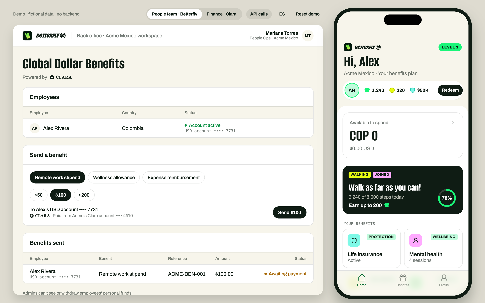
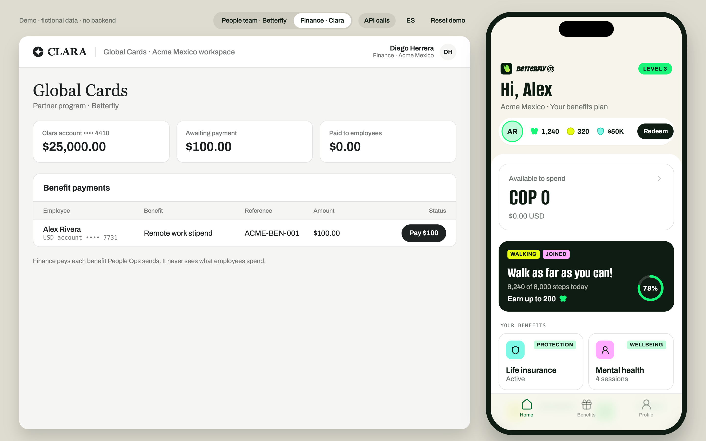
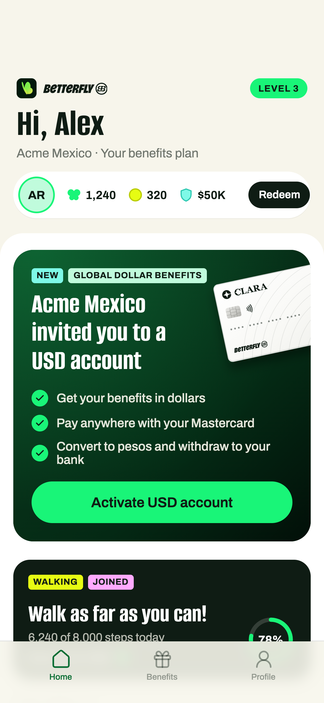
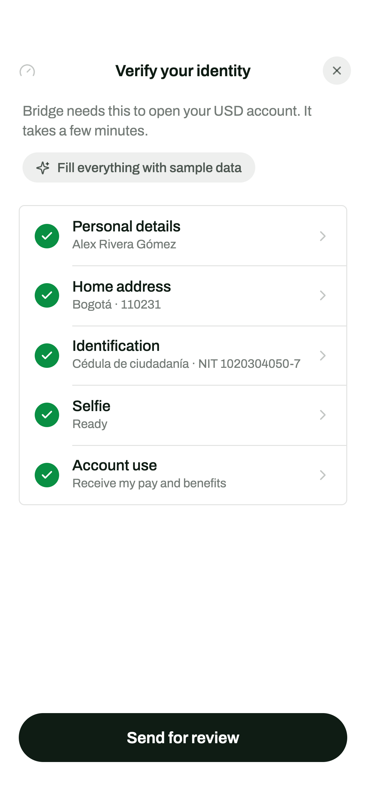
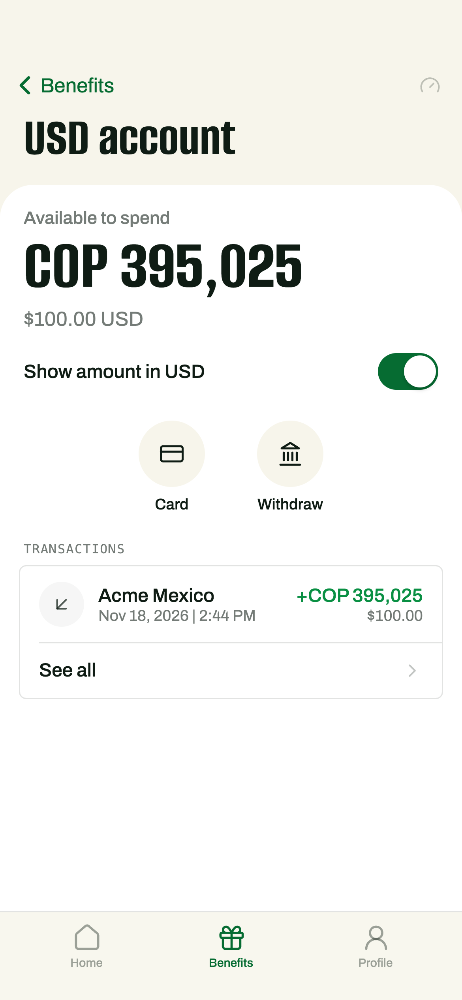
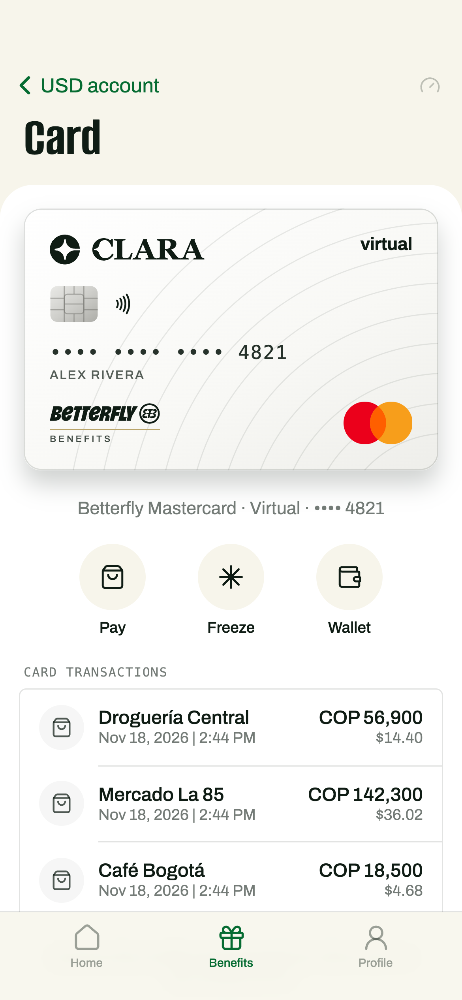
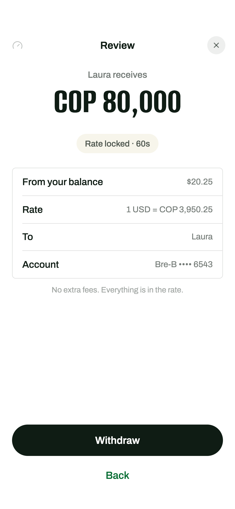

# relayer-mobiledemo

Demo Expo de **Global Dollar Benefits** dentro de la app de **Betterfly** (spec «Clara Global Cards — Mobile MVP»): invitación → verificación →
beneficio en USD → tarjeta virtual → compra → conversión USD → COP → retiro al banco, con sus estados de fallo.

**Todo es una simulación y todo es front.** No hay backend, KYC, emisor, procesador, stablecoin, FX ni banco reales: el estado vive en memoria
(`src/gdb/store.ts` sobre el ledger puro de `src/gdb/ledger.ts`). Los datos, montos, personas y cuentas son ficticios. La marca Betterfly y el
logo de Clara se usan en una demo interna hipotética; no implican un acuerdo real ni deben distribuirse.

- Caso: Acme Mexico → Alex Rivera (Colombia) → beneficio de $100 USD.
- Saldos: Available / Pending / Reserved, con la invariante Available = Posted − reservas (pruebas en `__tests__/gdbLedger.test.ts`).
- Consola de demo (icono discreto en la barra, o Perfil → Demo console): Reset, Approve KYC, fondeo pending / hold / release, Authorize $20,
  Clear, Settle, Freeze, Expire quote, Fail withdrawal, Confirm reversal.
- Back office de la empresa (invitar al empleado, enviar el beneficio, conciliación): no está en la app móvil. Es una vista web
  (`npx expo start --web` → `http://localhost:8081`, ventana de 1000 px o más) con el back office a la izquierda y el teléfono a la derecha.
  Betterfly y Clara son partners: arriba se cambia de mirada entre Recursos Humanos en Betterfly (invitar, enviar el beneficio) y Finanzas
  en Clara (el dinero sale de la cuenta de Acme en Clara).
- Idioma: inglés por defecto (copy del spec) y español, en Perfil.
- Compra con tarjeta: la tarjeta es de Clara (Mastercard) y los fondos están custodiados en Bridge. El detalle de una compra abre
  «Detrás del pago», la vista de demo con la autorización y el movimiento de fondos y settlement.

## Correr

```bash
npm install
npx expo prebuild --platform ios --clean   # genera ./ios (gitignored); repetir tras cambiar deps nativas o assets
npx expo run:ios                            # build + simulador por defecto (o --device <nombre-o-udid>)
npx expo start --ios                        # sólo Metro, con el dev client ya instalado
npm test && npm run typecheck
```

Deep links de desarrollo: `xcrun simctl openurl booted "relayermobiledemo://demo/seed/active"` (cuenta lista), `…/demo/open/<pantalla>` y
`…/demo/run/<acción>`.

## Arquitectura

```
App.tsx                 fuentes, ThemeProvider y la vista: teléfono solo, o back office + teléfono en web ancha
src/Shell.tsx           la app del empleado: banner de notificaciones, deep links de desarrollo, Navigator
src/gdb/                ledger.ts (ledger puro) · store.ts (reloj, procesos simulados, consola) · rail.ts (esquema del pago) · copy.ts (en/es)
src/gdb/screens/        activar, cuenta, tarjeta, pagar, detalle, «Detrás del pago», convertir/retirar, consola
src/host/               la app anfitriona de Betterfly (Inicio, Beneficios, Perfil)
src/backoffice/         back office de la empresa (solo web ancha)
src/navigation/         screens.ts / routes.ts (tabla pura), ref.ts (adaptador), Navigator.tsx
src/ui/                 theme.ts, kit, primitives, TabBar, CardArt
__tests__/              lógica pura (jest-expo)
```

## Identidad

`fi.relayer.mobiledemo`, esquema `relayermobiledemo://`, nombre «Betterfly» (proyecto nativo `ios/Betterfly.xcworkspace`). Icono y splash son los de la app de Betterfly; `node scripts/make-placeholder-assets.mjs` los sobrescribe con placeholders.
TestFlight: `scripts/ios-archive.sh` y `scripts/ios-upload.sh` (heredados; requieren `.env.asc` con la API key de App Store Connect, nunca commiteado;
subir `ios.buildNumber` en `app.config.ts` antes de cada subida).

## Capturas

Flujo actual, en inglés. Se generaron el 2026-11-18 recorriendo la demo completa en la vista web.

- `docs/screenshots/v2/`: 44 pantallas del teléfono, numeradas en el orden del guion, a 1170 × 2532 px (390 × 844 pt a 3x), rectangulares y sin marco de dispositivo.
- `docs/screenshots/v2/web/`: 8 capturas de la vista web (back office junto al teléfono), a 2880 × 1800 px.

| Tramo | Archivos |
|---|---|
| Inicio e invitación | `01`–`02` |
| Términos y documentos | `03`–`04` |
| KYC: secciones, formularios, revisión y correcciones | `05`–`15` |
| Cuenta, beneficio recibido y Beneficios | `16`–`19` |
| Tarjeta y pago sin contacto | `20`–`25` |
| Movimientos, detalle y «Detrás del pago» | `26`–`30` |
| Retiro: a quién, nueva cuenta, monto, revisar, estado | `31`–`40` |
| Compra rechazada, tarjeta congelada, Perfil y consola | `41`–`44` |
| Web: RH en Betterfly, Finanzas en Clara y llamadas de API | `web/01`–`web/08` |

| Recursos Humanos en Betterfly | Finanzas en Clara |
|---|---|
|  |  |

| Invitación | KYC | Cuenta USD | Tarjeta | Retiro |
|---|---|---|---|---|
|  |  |  |  |  |
