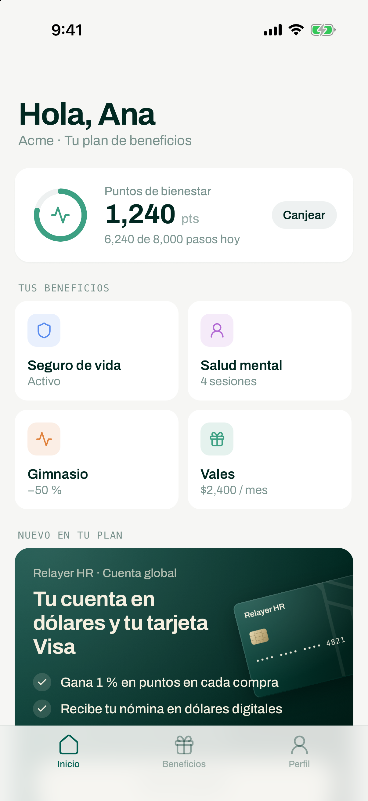
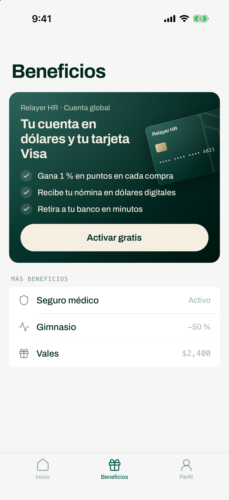
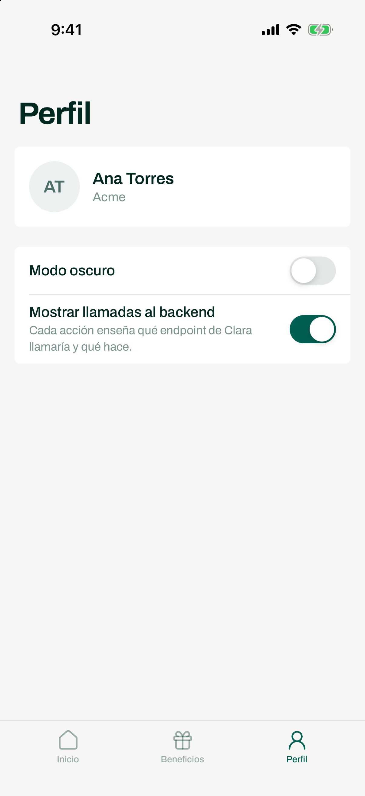
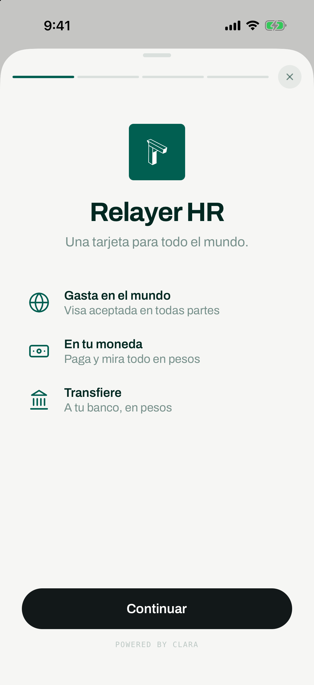
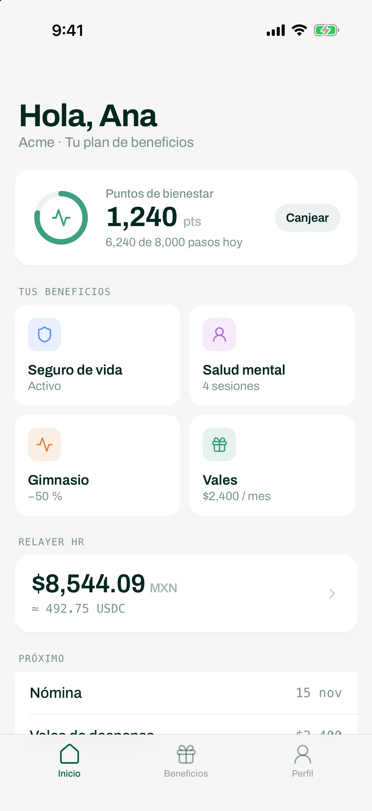
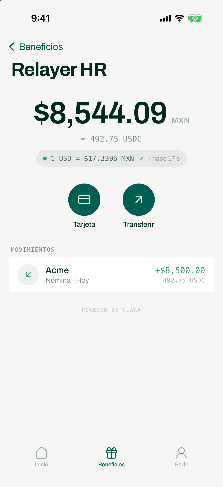
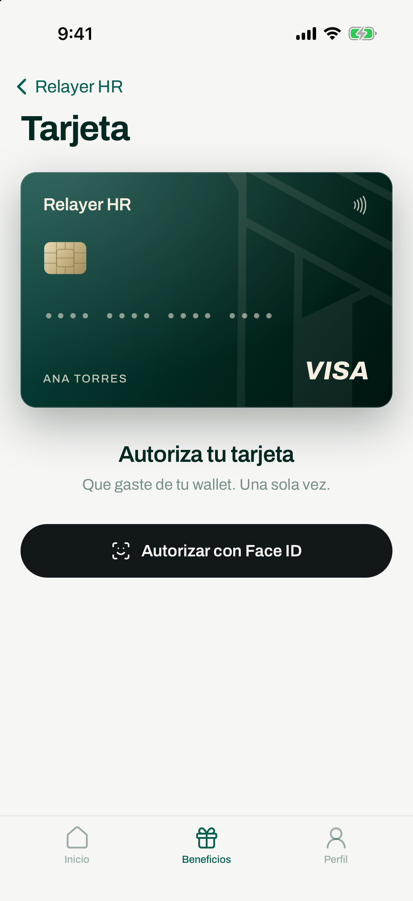
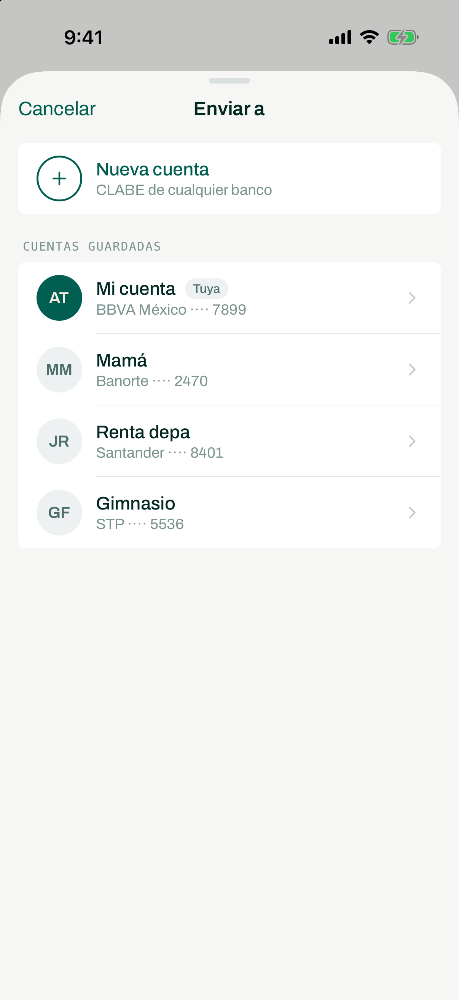
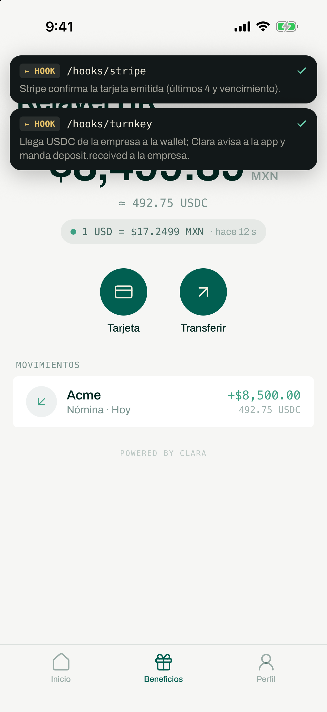
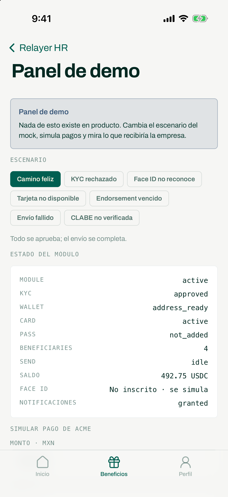

# relayer-mobiledemo

Demo Expo del módulo **Recibo** («powered by Relayer») embebido en una app de beneficios genérica, **Acme Beneficios**.
Todo corre contra una capa mock: no hay backend, ni Bridge, ni Turnkey, ni Stripe. Spec: `docs/specs/2026-11-11-relayer-mobiledemo-design.md`.

- Anfitriona: Inicio · Beneficios · Perfil (relleno estático). Beneficios tiene la tarjeta «Recibo · powered by Relayer».
- Módulo: activar → términos → KYC (proveedor simulado, regreso por deep link) → passkey con Face ID → saldo y depósitos → tarjeta Visa virtual
  (pedir, autorizar on-chain, ver, congelar, agregar al teléfono) → CLABE con verificación → envío por SPEI con cotización → recibo → ajustes.
- Panel de demo oculto (5 s sobre «powered by Relayer»): escenarios, simular pago de Acme, eventos que recibiría la empresa, reiniciar.
- Docs: `docs/data-model.md` (lo que persistirá el backend), `docs/events.md` (webhooks a la empresa), `docs/walkthrough.md` (checklist manual).

## Correr

```bash
npm install
npx expo prebuild --platform ios --clean   # genera ./ios (gitignored); repetir tras cambiar deps nativas o assets
npx expo run:ios                            # build + simulador por defecto (o --device <nombre-o-udid>)
npx expo start --ios                        # sólo Metro, con el dev client ya instalado
npm test && npm run typecheck
```

Face ID del simulador se pierde al reiniciarlo: Features → Face ID → Enrolled antes de un recorrido; sin inscripción la ceremonia se simula.
Deep link de prueba: `xcrun simctl openurl booted "relayermobiledemo://recibo/kyc-return"`.

## Arquitectura

```
App.tsx                 fuentes, ThemeProvider, AppCtx (store + module + faceId + notifications), deep link, Navigator
src/ui/                 theme.ts (tokens Relayer light/dark, portados de relayer-core apps/web/app/tokens.css), primitives, Page, TabBar
src/navigation/         screens.ts / routes.ts (tabla pura + gate por módulo activo), ref.ts (adaptador), Navigator.tsx
src/relayer/            types.ts · api.ts (RelayerModuleApi, la frontera) · state.ts (máquina pura) · money.ts · clabe.ts
src/relayer/mock/       mockApi.ts (memoria + latencias 300–1200 ms + procesos de fondo) · scenarios.ts · fixtures.ts
src/relayer/screens/    las 17 pantallas del módulo
src/host/screens/       las 3 de Acme
src/i18n/es.ts          todo el copy
__tests__/              lógica pura (jest-expo)
```

La fase de backend reemplaza `createMockApi` en `App.tsx` por un cliente HTTP que implemente `RelayerModuleApi`; las pantallas no cambian.

## Identidad

`fi.relayer.mobiledemo`, esquema `relayermobiledemo://`, nombre «Acme Beneficios». Icono y splash son placeholders (`node scripts/make-placeholder-assets.mjs`).
TestFlight: `scripts/ios-archive.sh` y `scripts/ios-upload.sh` (heredados; requieren `.env.asc` con la API key de App Store Connect, nunca commiteado;
subir `ios.buildNumber` en `app.config.ts` antes de cada subida).

## Capturas

Simulador iPhone 17 Pro, capa mock. Se regeneran con los deep links de desarrollo (`relayermobiledemo://demo/open/<pantalla>` y `…/demo/seed/active`).

| Inicio | Beneficios | Perfil | Alta |
|---|---|---|---|
|  |  |  |  |

| Inicio (módulo activo) | Saldo | Tarjeta | Transferir |
|---|---|---|---|
|  |  |  |  |

| Modo explicativo | Panel de demo |
|---|---|
|  |  |
